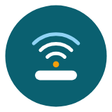
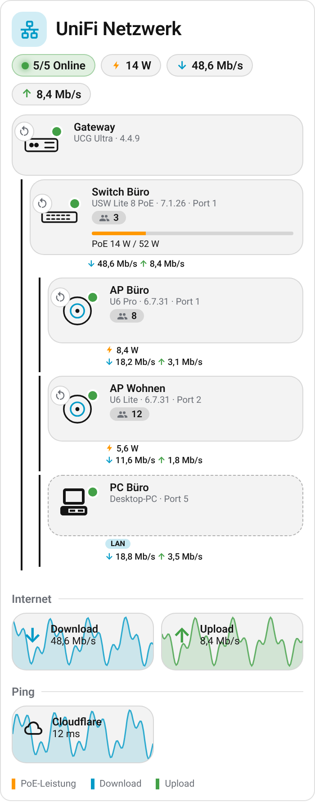

  

# UniFi Card

**English** | [Deutsch](https://github.com/BeGiBue/home-assistant-unifi-card#deutsch)

## English

Home Assistant card that shows your UniFi network as a topology: gateway → switches → access points, cameras and other devices, with PoE power and data rates on every connection.

### Features

- Reads devices directly from the [UniFi integration](https://www.home-assistant.io/integrations/unifi/); no extra backend
- Optional [UniFi Network+](https://github.com/42bios/unifi-network-plus): port usage, hierarchy and WAN data are detected automatically
- Animated lines for PoE, download and upload, PoE budget per switch, link aggregation
- Tap a device for status, IP, uptime and restart; tap a connection to turn PoE off/on or power-cycle it
- Internet throughput and ping with history
- Adapts to the width: tree, compact tiles or list; follows your theme; visual editor

The card is shown in German when Home Assistant is set to German, and in English otherwise.

### Requirements

- Home Assistant with the UniFi integration and/or UniFi Network+.
- A current Home Assistant version (the editor uses the `object` selector with `fields`).

### Quick start

Add a card and choose "UniFi Network Card". Without further settings it shows all UniFi devices.

To show values on the connections, the card needs the switch's **port sensors** (PoE power, download/upload or RX/TX). They are **disabled by default** in both integrations and must be enabled on the switch under *Entities*.

### How the card detects your network

**Hierarchy (what connects to what).** For each device the card uses the first available source:

1. `devices[].parent` in the card ("Upstream device" in the editor)
2. the relationship from the Home Assistant device registry
3. with UniFi Network+: the detected port usage (see below)
4. with `auto_parent: true` a rule of thumb: switches connect to the gateway, all other devices to the only switch. With several switches they connect to the gateway until you assign the right switch with `parent`.

**Port (for PoE and data values).** A connection's values come from the port sensors of the **upstream** device. The port is set in `devices[].switch_port` or detected automatically with UniFi Network+. The card finds the sensors by name ("Port 5 PoE Power", "… Download", "… RX"). If the names don't match, set `poe_entity`, `down_entity` and `up_entity` on the device directly. A port sensor measures from the switch's point of view: data received on the port is the **upload of the connected device**; the card converts this. If the arrows are still reversed for you, set `swap_port_direction: true`.

**With UniFi Network+.** The card reads devices from the core integration and from Network+, even when both run in parallel; devices with the same name are merged. Network+ adds:

- **Port usage:** the "Port N Link Speed" sensors name the device at the other end of the cable, so the card assigns access points, cameras and switches to the right port, and several ports to the same device as link aggregation.
- **Uplink:** the "Uplink" sensor of each access point and switch (Network+ 0.3 and later, enabled by default) names the upstream device and port. It works without link speed sensors and detects switches connected to another switch. If both sources exist, the link speed sensors win.
- **Named ports:** ports renamed in UniFi ("NAS") work too; you can enter the name in `switch_port`.
- **WAN throughput and WAN latency** for the internet and ping tiles.

Manual settings always take precedence over detection.

**Automatic detection in the editor.** The **"Restart automatic detection"** button (below the device list) writes everything detected into the configuration: one entry per UniFi device in `devices`, the ping sensors in `latency_entities` and the internet sensors, and sets `managed: true`. From then on the card shows only what is in the list, and **a deleted entry hides the device**. Clicking again only updates fields that the detection wrote itself (stored in `auto_detected`), e.g. after moving a cable; your own values stay unchanged. For a new card, detection runs once when the editor first opens. With `managed: false` the card shows everything again.

Independent community project, not affiliated with Ubiquiti or Home Assistant. **UniFi** is a trademark of Ubiquiti Inc. License: [AGPL-3.0-only](https://github.com/BeGiBue/home-assistant-unifi-card/blob/main/LICENSE).

## Deutsch

[English](https://github.com/BeGiBue/home-assistant-unifi-card#english) | **Deutsch**

Home-Assistant-Karte, die dein UniFi-Netzwerk als Topologie zeigt: Gateway → Switches → Access Points, Kameras und weitere Geräte, mit PoE-Leistung und Datenraten an jeder Verbindung.

### Funktionen

- Liest die Geräte direkt aus der [UniFi-Integration](https://www.home-assistant.io/integrations/unifi/), kein zusätzliches Backend
- Optional mit [UniFi Network+](https://github.com/42bios/unifi-network-plus): Portbelegung, Hierarchie und WAN-Daten werden automatisch erkannt
- Animierte Linien für PoE, Download und Upload, PoE-Budget je Switch, Link Aggregation
- Tippen auf ein Gerät: Status, IP, Betriebszeit, Neustart; Tippen auf eine Verbindung: PoE aus/ein, PoE-Neustart
- Internet-Durchsatz und Ping mit Verlauf
- Passt sich der Breite an: Baum, kompakte Kacheln oder Liste; folgt dem Theme; grafischer Editor

Die Karte erscheint auf Deutsch, wenn Home Assistant auf Deutsch eingestellt ist, sonst auf Englisch.

### Voraussetzungen

- Home Assistant mit der UniFi-Integration und/oder UniFi Network+.
- Eine aktuelle Home-Assistant-Version (der Editor nutzt den `object`-Selektor mit `fields`).

### Schnellstart

Karte hinzufügen und „UniFi Network Card“ wählen. Ohne weitere Einstellungen zeigt sie alle UniFi-Geräte an.

Damit an den Verbindungen Werte stehen, braucht die Karte die **Port-Sensoren** des Switches (PoE-Leistung, Download/Upload bzw. RX/TX). Sie sind in beiden Integrationen **standardmäßig deaktiviert** und müssen am Switch unter *Entitäten* aktiviert werden.

### Wie die Karte dein Netzwerk erkennt

**Hierarchie (wer hängt woran).** Für jedes Gerät nimmt die Karte die erste Angabe, die vorhanden ist:

1. `devices[].parent` aus der Karte (im Editor „Übergeordnetes Gerät“)
2. die Beziehung aus der Geräte-Registry von Home Assistant
3. mit UniFi Network+: die erkannte Portbelegung (siehe unten)
4. bei `auto_parent: true` eine Faustregel: Switches hängen am Gateway, alle anderen Geräte am einzigen Switch. Gibt es mehrere Switches, hängen sie am Gateway, bis du per `parent` den richtigen Switch zuweist.

**Port (für PoE- und Datenwerte).** Die Werte einer Verbindung kommen von den Port-Sensoren des **übergeordneten** Geräts. Welcher Port gemeint ist, steht in `devices[].switch_port` oder wird mit UniFi Network+ automatisch erkannt. Die Sensoren findet die Karte am Namen („Port 5 PoE Power“, „… Download“, „… RX“). Passen die Namen nicht, gibst du `poe_entity`, `down_entity` und `up_entity` am Gerät direkt an. Ein Port-Sensor misst aus Sicht des Switches: Empfang am Port ist der **Upload des angeschlossenen Geräts**; die Karte rechnet das um. Sind die Pfeile trotzdem vertauscht, setze `swap_port_direction: true`.

**Mit UniFi Network+.** Die Karte liest Geräte aus der Core-Integration und aus Network+, auch wenn beide parallel laufen; gleichnamige Geräte werden zusammengeführt. Network+ bringt diese Erkennung mit:

- **Portbelegung:** Die Sensoren „Port N Link Speed“ nennen das Gerät am anderen Kabelende. Damit ordnet die Karte Access Points, Kameras und Switches dem richtigen Port zu, mehrere Ports zum selben Gerät als Link Aggregation.
- **Uplink:** Der Sensor „Uplink“ je Access Point und Switch (ab Network+ 0.3, standardmäßig aktiv) nennt das übergeordnete Gerät und den Port. Er reicht auch ohne Link-Speed-Sensoren und erkennt Switches, die an einem anderen Switch hängen. Sind beide Quellen da, gewinnen die Link-Speed-Sensoren.
- **Benannte Ports:** In UniFi umbenannte Ports („NAS“) funktionieren ebenfalls; in `switch_port` kannst du dann den Namen eintragen.
- **WAN-Durchsatz und WAN-Latenz** für die Internet- und Ping-Kacheln.

Manuelle Angaben haben immer Vorrang vor der Erkennung.

**Automatische Erkennung im Editor.** Der Button **„Automatische Erkennung neu starten“** (unter der Geräteliste) schreibt alles Erkannte in die Konfiguration: je UniFi-Gerät einen Eintrag in `devices`, die Ping-Sensoren in `latency_entities` und die Internet-Sensoren, und setzt `managed: true`. Ab dann zeigt die Karte nur, was in der Liste steht, und **ein gelöschter Eintrag blendet das Gerät aus**. Ein erneuter Klick aktualisiert nur die Felder, die die Erkennung selbst geschrieben hat (gemerkt unter `auto_detected`), etwa nach dem Umstecken eines Kabels; eigene Werte bleiben unangetastet. Bei einer neuen Karte läuft die Erkennung beim ersten Öffnen des Editors einmal von selbst. Mit `managed: false` zeigt die Karte wieder alles an.

Unabhängiges Community-Projekt, ohne Verbindung zu Ubiquiti oder Home Assistant. **UniFi** ist eine Marke der Ubiquiti Inc. Lizenz: [AGPL-3.0-only](https://github.com/BeGiBue/home-assistant-unifi-card/blob/main/LICENSE).
